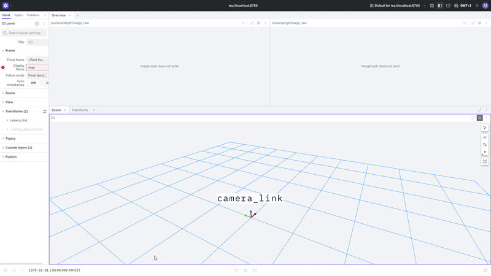
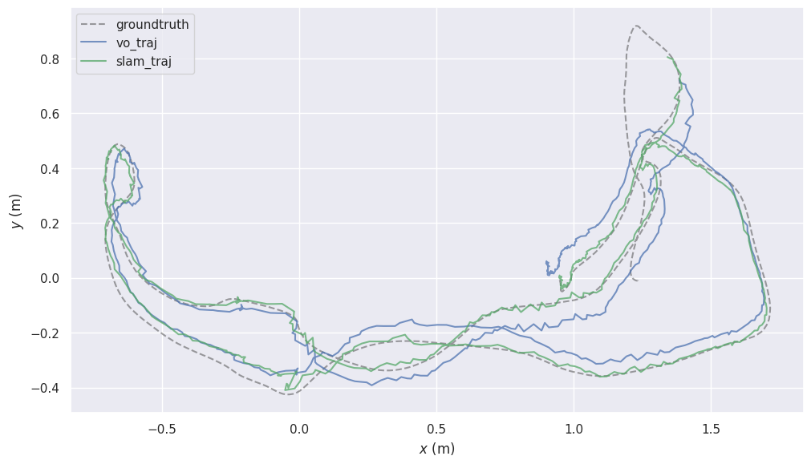

# RGB-D SLAM in ROS 2, fully Dockerized, with my own visual odometry

A ROS 2 Humble pipeline that runs RGB-D SLAM on the TUM RGB-D benchmark inside Docker and evaluates
it against motion-capture ground truth with [evo](https://github.com/MichaelGrupp/evo):

- **Stage 1:** RTAB-Map (odometry + graph SLAM) fed by a custom ROS 2 dataset player.
- **Stage 2:** my own RGB-D visual odometry node (ORB + frame-to-keyframe PnP/RANSAC), which can
  replace RTAB-Map's odometry and feed RTAB-Map's SLAM back end.

One command to run, one command to evaluate.



## Results

Absolute trajectory error (ATE, translation RMSE after SE(3) Umeyama alignment), **mean ± std over
3 runs** (RANSAC and message timing make runs non-deterministic). Calibrated fr1 intrinsics, map
updated on every frame.

| Odometry → SLAM back end | fr1/xyz VO | fr1/xyz SLAM | fr1/desk VO | fr1/desk SLAM |
|---|---|---|---|---|
| RTAB-Map odometry → RTAB-Map | 3.28 ± 0.00 cm | **1.14 ± 0.02 cm** | 6.42 ± 0.80 cm | **2.67 ± 0.21 cm** |
| **My VO** → RTAB-Map | **2.44 ± 0.00 cm** | 1.48 ± 0.03 cm | 7.11 ± 0.00 cm | 3.22 ± 0.05 cm |

My VO runs at 37–43 ms/frame in plain Python on an idle laptop (~25 fps) and lost no frame in any of the 6 runs.

*fr1/desk: my VO (blue) and my VO + RTAB-Map back end (green) against motion-capture ground truth.*



**Reading**

- **My VO beats RTAB-Map's odometry on fr1/xyz by 25 %** (2.44 vs 3.28 cm, far outside the
  run-to-run spread). On the faster fr1/desk it is on par: 7.11 cm against 6.42 ± 0.80 cm, within
  RTAB-Map's own variation. It is also **deterministic** (identical ATE in all 3 runs, because every
  frame is processed), while RTAB-Map's odometry varies by ±0.8 cm on desk.
- **The SLAM back end is what removes drift:** on fr1/desk it cuts the error from ~7 cm to
  2.7 cm by recognising previously seen places and re-optimising the pose graph.
- **With the back end on top, RTAB-Map's own pipeline stays ahead** (xyz 1.14 vs 1.48 cm,
  desk 2.67 vs 3.22 cm). RTAB-Map's odometry hands the back end its tracked features and a real
  per-frame uncertainty; mine sends only the pose with a fixed covariance. Passing a proper
  covariance is the next step (roadmap).

### Ablation: what made the difference (fr1/desk, RTAB-Map pipeline, single runs)

| Intrinsics | Map update | VO ATE | SLAM ATE |
|---|---|---|---|
| ROS default (525 px, no distortion) | 1 Hz | 9.07 cm | 7.59 cm |
| calibrated fr1 + undistortion | 1 Hz | 7.21 cm | 7.20 cm |
| ROS default | every frame | 7.77 cm | 3.24 cm |
| **calibrated fr1 + undistortion** | **every frame** | **7.07 cm** | **2.45 cm** |

- Updating the map on every frame is the big win: at 1 Hz the back end gets few chances to close
  loops, so SLAM barely improves on odometry.
- Calibration consistently improves odometry (both pairs). Its effect on SLAM alone is within the
  run-to-run noise (~±1 cm on desk), so I do not claim it.

## Stage 2: my RGB-D visual odometry

[`scripts/vo_core.py`](scripts/vo_core.py) (pure NumPy/OpenCV, no ROS) and its ROS 2 wrapper
[`scripts/rgbd_vo_node.py`](scripts/rgbd_vo_node.py):

1. ORB features (2000) on the grey image.
2. Descriptor matching against the current **keyframe** with Lowe's ratio test.
3. Keyframe features with valid depth are back-projected to 3D → 3D-2D correspondences.
4. `solvePnPRansac` (EPnP, 2 px threshold) then Levenberg-Marquardt refinement on the inliers.
5. Pose composition `T_w_cur = T_w_kf · T_cur_kf⁻¹`; a new keyframe is taken when inliers drop below 150.

Matching against a keyframe instead of the previous frame means that while the camera looks at the
same area, every frame is measured against the same reference, so errors do not pile up
(fr1/xyz: 33 keyframes for 789 frames).

The node synchronises RGB, depth and camera info by exact timestamp, converts optical-frame poses to
`camera_link`, and publishes `nav_msgs/Odometry` + tf, so RTAB-Map's SLAM node consumes it unchanged.

**Unit test:** [`tests/test_vo_core.py`](tests/test_vo_core.py) renders a textured scene from known
camera poses (exact RGB + depth by ray casting) and checks the recovered trajectory
(drift < 4 % of the distance travelled; 2.7 % with the OpenCV 4.5 in the container).

```bash
docker compose run --rm eval python3 /ws/tests/test_vo_core.py
```

## Pipeline

```
TUM sequence (PNG) ─► tum_publisher ─► /camera/rgb, /camera/depth, /camera_info, /clock
                                              │
                    ┌─────────────────────────┴──────────────────────┐
                    ▼                                                ▼
     RTAB-Map RGB-D odometry  (ODOMETRY=rtabmap)        my rgbd_vo_node  (ODOMETRY=mine)
                    └──────────────► odom → camera_link ◄────────────┘
                                              │
                                              ▼
                              RTAB-Map graph SLAM (map → odom)
                                              │
                 trajectory_recorder ─► vo_traj.txt / slam_traj.txt ─► evo (ATE)
```

## Quick start

Requirements: Docker (Docker Desktop on Windows/macOS). Nothing else on the host.

```bash
# 1. Get a sequence (~0.4 GB)
cd data
curl -L -o fr1_xyz.tgz https://cvg.cit.tum.de/rgbd/dataset/freiburg1/rgbd_dataset_freiburg1_xyz.tgz
tar -xzf fr1_xyz.tgz && cd ..

# 2. Build and run (stops by itself at the end of the sequence)
docker compose up --build slam

# 3. Evaluate (plots and tables land in results/<run>/)
docker compose run --rm eval
```

Settings (environment variables; PowerShell: `$env:NAME="value"` first):

| Variable | Default | Meaning |
|---|---|---|
| `SEQUENCE` | `rgbd_dataset_freiburg1_xyz` | folder in `data/` |
| `ODOMETRY` | `rtabmap` | `rtabmap` or `mine` |
| `INTRINSICS` | `fr1` | `fr1` (calibrated + undistortion) or `default` (ROS 525 px) |
| `DETECTION_RATE` | `0` | RTAB-Map map update rate in Hz, `0` = every frame |
| `RUN` | sequence name | output subfolder in `results/` |
| `SPEED` | `0.3` | playback speed (timestamps are preserved, so this only affects wall time) |

Live view: [Foxglove](https://app.foxglove.dev) → `ws://localhost:8765`, 3D panel, display frame `map`.

## Engineering notes

Getting large images through ROS 2 reliably took more than wiring nodes together:

- **Custom dataset player instead of the official rosbags.** The TUM bags are ROS 1, use frame ids with a
  leading `/` (rejected by tf2 in ROS 2) and publish mocap ground truth on `/tf`, which conflicts with the
  SLAM tf tree. The player replays the PNGs with dataset time on `/clock`, so every estimate keeps the
  timestamp of its ground-truth pose.
- **Middleware tuned for images.** Fast DDS's default shared-memory segment (512 KB) is smaller than one
  RGB (0.9 MB) or depth (1.2 MB) frame, so frames fell back to fragmented UDP and RTAB-Map's exact-time
  synchroniser received ~1 % of RGB/depth/info triplets. A Fast DDS profile with 64 MB segments
  (`config/fastdds.xml`) plus a 2 GB container `/dev/shm` brought that to 100 %.
- **rclpy fast path.** Assigning image bytes to `Image.data` makes rclpy validate every byte in Python;
  passing an `array.array` instead raised the player from ~3 to ~10+ fps.
- **Two trajectories from one run.** `vo` is pure odometry (`odom → camera_link`); `slam` composes
  RTAB-Map's `map → odom` correction, so each table row isolates what the SLAM back end contributes.
- **Measure the noise before claiming a gain.** Identical runs differ by ~1 cm ATE on fr1/desk, which is
  why the main table reports mean ± std over 3 runs.

## Repository layout

```
Dockerfile, docker-compose.yml   ROS 2 Humble + RTAB-Map + Foxglove bridge + evo
config/fastdds.xml               middleware profile for large images
launch/tum_slam.launch.py        player, odometry (RTAB-Map or mine), SLAM, recorder, Foxglove
scripts/tum_publisher.py         TUM sequence → ROS 2 topics (+ optional undistortion)
scripts/vo_core.py               my RGB-D visual odometry (no ROS)
scripts/rgbd_vo_node.py          ROS 2 wrapper for it
scripts/trajectory_recorder.py   odometry / SLAM poses → TUM-format trajectories
scripts/evaluate.sh              evo APE, plots and summary
tests/test_vo_core.py            synthetic-scene unit test for the VO
```

## Roadmap

- [x] Stage 1: Dockerized ROS 2 + RTAB-Map + evo evaluation on TUM RGB-D
- [x] Calibrated intrinsics and per-frame map updates (ablation above)
- [x] Stage 2: my own RGB-D visual odometry node, plugged into RTAB-Map's back end
- [ ] Pass real pose covariance (from the PnP inliers) and features to the back end
- [ ] Stage 3: own back end: GTSAM pose graph and bag-of-words loop closure
